# angomart-mcp

[](https://modelcontextprotocol.io)
[](https://www.python.org/)
[](LICENSE)
[]()

Servidor MCP não-oficial para o **AngoMart** (Angola). Permite que Claude, Cursor, ChatGPT ou qualquer cliente MCP consulte lojas, categorias e produtos directamente do catálogo online do AngoMart.



> Não-oficial. Este projeto é independente do AngoMart e da Jungleworks. Usa a API pública do site e pode deixar de funcionar se o site mudar.

Inspirado no [continente-mcp](https://github.com/andredelgado/continente-mcp) do André Delgado.

## Ferramentas

| Ferramenta | Função |
|---|---|
| `angomart_list_stores` | Lista lojas AngoMart ordenadas por proximidade (lat/long) |
| `angomart_list_categories` | Árvore de categorias de uma loja |
| `angomart_get_products_by_category` | Produtos de uma categoria |
| `angomart_search_products` | Pesquisa produtos por nome numa loja |

## Instalação

```bash
git clone https://github.com/rasgadocarlos2-jpg/angomart-mcp.git
cd angomart-mcp
python -m venv venv
source venv/bin/activate   # Windows: venv\Scripts\activate
pip install -r requirements.txt
```

## Configuração no Claude Desktop

Edita `claude_desktop_config.json`:

```json
{
  "mcpServers": {
    "angomart": {
      "command": "python",
      "args": ["/caminho/completo/para/server.py"]
    }
  }
}
```

Reinicia o Claude Desktop. Testa com:

> Lista as lojas AngoMart mais próximas. Depois procura "arroz" na loja de Talatona.

## Exemplos

```
> angomart_list_stores
- AngoMart Talatona (store_id: 1736945)
- AngoMart Vila Alice (store_id: ...)
- AngoMart Nova Vida (store_id: ...)

> angomart_list_categories(store_id=1736945)
- FRUTAS & LEGUMES (11908658)
- CARNES & CONGELADOS (11903313)
  - CARNES & CONGELADOS (11903334)
  - GELO (11903335)
- CEREAIS, MASSAS E GRÃOS (11903315)
  - ARROZ (11903343)
  - MASSAS & NOODLES (11903342)
...

> angomart_get_products_by_category(store_id=1736945, catalogue_id=11908658)
- ANANAS KG — 690 Kz — stock: 137
- TOMATE CHUCHA 1.K.G — 2.490 Kz — stock: 30
- MELANCIA KG — 790 Kz — stock: 328
...
```

## Como funciona

O AngoMart está construído sobre a plataforma **Yelo (Jungleworks)** e expõe uma API JSON pública para browsing. Este MCP faz chamadas directas a:

- `GET /api/marketplace/marketplace_get_city_storefronts_v3` — lojas por cidade
- `POST /api/catalogue/get` — árvore de categorias
- `POST /api/get_products_for_category` — produtos por categoria

Sem Playwright, sem scraping HTML. Só JSON.

## Limitações

- Não faz login, não adiciona ao carrinho, não submete encomendas (por desenho).
- A pesquisa por nome é client-side (itera categorias) — lenta em lojas grandes.
- Preços e stock podem estar desatualizados em relação à loja física.
- A listagem de lojas (`angomart_list_stores`) funciona directamente. As ferramentas de catálogo e produtos usam endpoints que o AngoMart protege contra scraping directo: podem retornar `status: 100` fora do navegador. Duas formas de contornar:
  1. **Playwright fallback** (recomendado): `pip install playwright && playwright install chromium`. O server detecta automaticamente `status: 100` e refaz a chamada dentro de um Chromium headless.
  2. **Cookie manual**: define `ANGOMART_COOKIE` com o header `Cookie` copiado das DevTools do browser.

## Roadmap

- [x] Fallback Playwright para endpoints protegidos (como o continente-mcp faz)
- [ ] Suporte a outras cidades / coordenadas por configuração
- [ ] Adaptador `kibabo-mcp` (loja Kibabo em Angola, stack Redicom Prolepse)
- [ ] Adaptador `tupuca-mcp` (super-app de delivery angolana, mesma stack Yelo)

## Licença

MIT. Vê [LICENSE](LICENSE).
